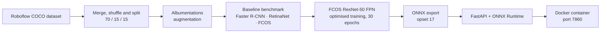
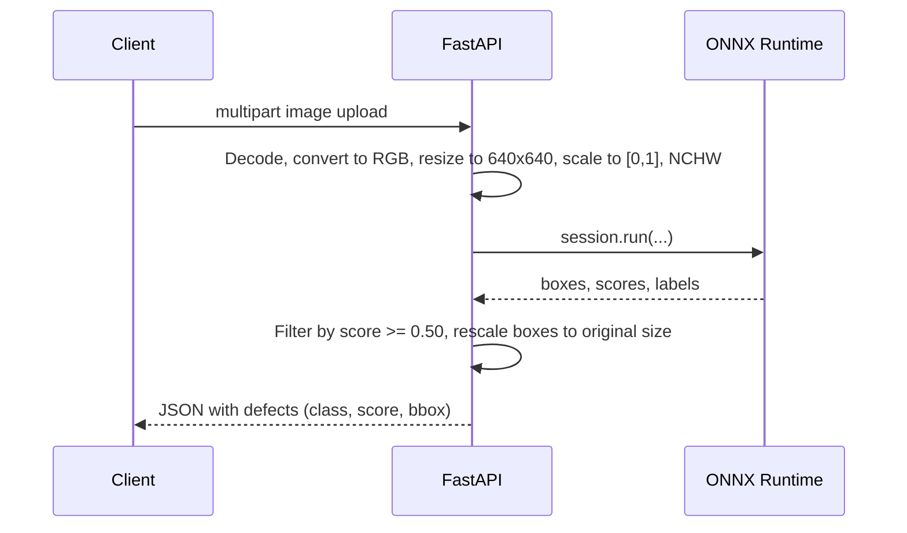

# PCB Defect Detection — FCOS + ONNX + FastAPI

End-to-end object detection pipeline for **printed circuit board (PCB) manufacturing defects**: from dataset preparation and model benchmarking, through optimised training and ONNX export, to a containerised REST API for real-time inference.

# PCB Defect Detection API (FCOS)

The API is deployed as a Docker container on Render and is ready for live inference:

> **Live API Service:** [https://pcb-fcos-api.onrender.com](https://pcb-fcos-api.onrender.com)  
> **Interactive API Docs (Swagger UI):** [https://pcb-fcos-api.onrender.com/docs](https://pcb-fcos-api.onrender.com/docs)
>
> **Note:** The service is hosted on Render's free tier. If the instance has been idle, the first request may take around 30–40 seconds to spin up. Subsequent requests will execute in standard speed but that is also slow.


---

## Table of Contents

- [Overview](#overview)
- [Architecture](#architecture)
- [Dataset & Classes](#dataset--classes)
- [Model Selection & Results](#model-selection--results)
- [Training Details](#training-details)
- [Final Test Results](#final-test-results)
- [Repository Structure](#repository-structure)
- [Getting Started](#getting-started)
- [API Usage](#api-usage)
- [Notes & Limitations](#notes--limitations)
- [Acknowledgements](#acknowledgements)

---

## Overview

This project detects and classifies **8 types of PCB defects** in board images. Three detectors were benchmarked under identical conditions (Faster R-CNN, RetinaNet, FCOS), and **FCOS ResNet-50 FPN** was selected as the production model for its speed–accuracy trade-off. The trained model is exported to **ONNX** and served through a **FastAPI** application packaged in a **Docker** image.

**Highlights**

- Reproducible COCO-format data pipeline (deterministic 70 / 15 / 15 split, seed 42)
- Albumentations augmentation tuned for PCB imagery (flips, 90° rotations, CLAHE, coarse dropout)
- Fair three-model benchmark: accuracy (mAP), latency, FPS and VRAM
- Optimised FCOS training with linear warm-up + cosine annealing and best-checkpoint selection
- ONNX export with dynamic batch / height / width axes
- Lightweight inference service: PyTorch is **not** required at serving time

---

## Architecture

### Pipeline



### Inference flow (`POST /predict`)



The ONNX session is created once at application start-up (FastAPI `lifespan`) and reused across requests. It requests `CUDAExecutionProvider` first and falls back to `CPUExecutionProvider`.

---

## Dataset & Classes

- **Source:** PCB defect dataset in COCO format, distributed via Roboflow Universe ([dataset](https://universe.roboflow.com/hubei-university-of-technology-rmbpi/pcb-ecjga)).
- **Re-splitting:** the original `train` / `valid` splits are merged (with an ID offset of 10 000 to avoid collisions), shuffled deterministically, and re-partitioned into **70 % train / 15 % validation / 15 % test**. The test set is used only once, for the final evaluation.
- **Annotation handling:** COCO `[x, y, w, h]` boxes are converted to `[xmin, ymin, xmax, ymax]`; degenerate boxes (< 2 × 2 px after augmentation) are discarded.
- **Class layout:** index `0` is reserved for background; indices `1–8` are defect classes.

| ID | Class | Description |
|----|-------|-------------|
| 1 | `spurious_copper` | Unwanted copper residue left on the board |
| 2 | `missing_hole` | A required drill hole is absent |
| 3 | `mouse_bite` | Small irregular notches along a trace or board edge |
| 4 | `open_circuit` | A break in a conductive trace |
| 5 | `pinhole` | Tiny voids or holes in the copper/laminate |
| 6 | `scratch` | Surface scratch (spelled as in the dataset labels) |
| 7 | `short` | Unintended connection between conductors |
| 8 | `spur` | Small copper protrusion from a trace |

### Augmentation (training only)

| Group | Transforms |
|-------|------------|
| Geometric | `HorizontalFlip`, `VerticalFlip`, `RandomRotate90` — boards can arrive in any orientation |
| Photometric | `CLAHE`, `RandomBrightnessContrast` — robustness to lighting variation |
| Regularisation | `CoarseDropout` — mild occlusion / noise simulation |

Validation and test data only receive a deterministic resize to 640 × 640.

---

## Model Selection & Results

Three architectures with COCO-pretrained ResNet-50 FPN backbones were trained for **10 epochs** under identical settings (input 640 × 640, batch size 8, AdamW). Results on the validation set (approximate):

| Model | Paradigm | mAP@0.50 | mAP@0.50:0.95 | mAP@medium | Latency (ms/img) | FPS | Peak VRAM (MB) |
|-------|----------|:--------:|:-------------:|:----------:|:----------------:|:---:|:--------------:|
| Faster R-CNN | Two-stage, anchor-based | ~0.859 | ~0.399 | ~0.491 | ~13.7 | ~72 | ~3477 |
| RetinaNet | One-stage, anchor-based | ~0.784 | ~0.311 | ~0.454 | ~13.3 | ~74 | ~2552 |
| **FCOS** | One-stage, anchor-free | **~0.849** | **~0.418** | **~0.578** | **~12.1** | **~82** | **~2552** |

**Why FCOS?**

- Within ~1 point of Faster R-CNN on mAP@0.50 while running ~14 % faster.
- Roughly 925 MB lower peak VRAM than Faster R-CNN.
- Best mAP@0.50:0.95 and clearly better on medium-sized defects, with no anchor tuning required.

---

## Training Details

Production model: **FCOS ResNet-50 FPN** (`torchvision`).

| Setting | Value |
|---------|-------|
| Epochs | 30 |
| Optimiser | AdamW (`lr = 2e-4`, `weight_decay = 1e-4`) |
| LR schedule | 3 epochs linear warm-up, then `CosineAnnealingLR` (`eta_min = 1e-6`) |
| Gradient clipping | max norm 1.0 |
| Classification-head init | Focal-loss bias prior (`p = 0.01`) |
| Validation | mAP every 5 epochs; checkpoint saved when mAP@0.50 improves |
| Input size | 640 × 640 |

### ONNX export

- Exporter: legacy TorchScript exporter (`dynamo=False`), opset 17
- Input node: `images` with dynamic axes for batch size, height and width
- `NUM_CLASSES` is read automatically from the checkpoint's classification head
- Output file: `fcos_pcb_model.onnx`

---

## Final Test Results

The best checkpoint (selected by validation mAP@0.50) was evaluated **once** on the held-out test split (15 % of the data):

| Metric | Score |
|--------|:-----:|
| **mAP@0.50** | **0.9417** |
| **mAP@0.50:0.95** | **0.5499** |
| mAP@small | 0.5160 |
| mAP@medium | 0.4753 |

---

## Repository Structure

```text
pcb-defect-detection/
├── app/
│   ├── __init__.py                  # Python package definition
│   ├── main.py                      # FastAPI backend and endpoints
│   ├── model.py                     # ONNX Runtime inference logic
│   └── utils.py                     # Pre/post-processing and bounding-box drawing helpers
├── assets/
│   ├── 01_pinhole_05.jpg           # Sample PCB image for the test client
│   
├── models/
│   └── .gitkeep                     # Keeps the empty folder tracked by Git
├── notebooks/
│   └── pcb-fcos-defect-detection.ipynb      # Training, Albumentations, benchmarking and ONNX export
├── .dockerignore                    # Files excluded from the Docker build context
├── .gitattributes                   # Git configuration
├── .gitignore                       # Excludes model weights (*.onnx, *.pth) and virtual environments
├── Dockerfile                       # Container configuration
├── README.md                        # Project overview, setup instructions and model download link
├── requirements.txt                 # Dependency list
└── test_client.py                   # Client script for testing the API endpoint
```

> Model weights (`*.onnx`, `*.pth`) are not tracked in Git. Download `fcos_pcb_model.onnx` from [GitHub Releases](https://github.com/tolgaguclu17/PCB-Defect-Detection-Fcos-Api/releases/download/v1.0.0/fcos_pcb_model.onnx) and place it in `models/`.

---

## Getting Started

### 1. Train and export the model (optional)

The notebook is written for **Google Colab** (it mounts Google Drive to read the dataset archive).

1. Upload `notebooks/pcb-fcos-defect-detection.ipynb` to Colab and select a GPU runtime.
2. Place the dataset archive (`PCB.v1-pcb-defect-v1.coco.zip`) in your Drive, or adjust the path in Section 2.
3. Run all cells. The notebook produces `fcos_pcb_optimized_best.pth` and `fcos_pcb_model.onnx`.
4. Copy the ONNX file to `models/fcos_pcb_model.onnx` (or download the pre-exported file from [GitHub Releases](https://github.com/tolgaguclu17/PCB-Defect-Detection-Fcos-Api/releases/download/v1.0.0/fcos_pcb_model.onnx)).

### 2. Run the API locally

```bash
# run from the repository root so that models/fcos_pcb_model.onnx is found
python -m venv .venv
source .venv/bin/activate            # Windows: .venv\Scripts\activate
pip install -r requirements.txt
uvicorn app.main:app --host 0.0.0.0 --port 7860
```

Minimal `requirements.txt`:

```text
fastapi
uvicorn[standard]
python-multipart
onnxruntime            # use onnxruntime-gpu for CUDA inference
numpy
pillow
pydantic
```

The service starts on `http://localhost:7860`. Interactive Swagger docs are available at `http://localhost:7860/docs`.

### 3. Run with Docker

```bash
# build from the repository root (models/fcos_pcb_model.onnx must be present)
docker build -t pcb-fcos-api .

# run
docker run --rm -p 7860:7860 pcb-fcos-api
```

The image is based on `python:3.10-slim`, installs the dependencies from `requirements.txt`, copies the application (including the ONNX model) and serves it with Uvicorn on port **7860**.

> The default image is CPU-only. For GPU inference, install `onnxruntime-gpu` and use a CUDA-enabled base image; the service will pick up `CUDAExecutionProvider` automatically when it is available.

---

## API Usage

### `GET /` — health check

```bash
curl http://localhost:7860/
```

```json
{ "status": "ok", "message": "The server is up" }
```

### `POST /predict` — detect defects

Upload a PCB image as `multipart/form-data` using the form field name **`file`**.

**cURL**

```bash
curl -X POST "http://localhost:7860/predict" \
  -H "accept: application/json" \
  -F "file=@assets/01_pinhole_05.jpg"
```

**Python**

```python
import requests

with open("assets/01_pinhole_05.jpg", "rb") as f:
    response = requests.post(
        "http://localhost:7860/predict",
        files={"file": ("assets/01_pinhole_05.jpg", f, "image/jpeg")},
    )

result = response.json()
print(result["message"])
for defect in result["found_defects"]:
    print(defect["class_name"], round(defect["score"], 3), defect["bboxes"])
```

**Example response** (values are illustrative)

```json
{
  "message": "File 'sample_pcb.jpg' processed. Found 2 defect(s).",
  "found_defects": [
    {
      "class_name": "open_circuit",
      "score": 0.93,
      "bboxes": [412.7, 188.2, 468.9, 240.5]
    },
    {
      "class_name": "mouse_bite",
      "score": 0.71,
      "bboxes": [97.4, 305.0, 131.8, 338.6]
    }
  ]
}
```

**Response schema**

| Field | Type | Description |
|-------|------|-------------|
| `message` | string | Summary containing the file name and number of detections |
| `found_defects` | array | List of detected defects (empty if none pass the threshold) |
| `found_defects[].class_name` | string | Defect class name (`Class_<id>` if the ID is unknown) |
| `found_defects[].score` | float | Confidence score |
| `found_defects[].bboxes` | float[4] | `[xmin, ymin, xmax, ymax]` in **original image pixel coordinates** |

### Processing details

- The image is converted to RGB and resized to **640 × 640** (no letterboxing); pixel values are scaled to `[0, 1]` and arranged as NCHW. Normalisation with ImageNet statistics is performed inside the torchvision model graph.
- Detections with a score **below 0.50** are discarded (`score_thresh=0.50` parameter in `main.py`).
- Boxes are rescaled from the 640 × 640 model space back to the uploaded image's resolution.

## Notes & Limitations

- Images are resized to a square 640 × 640 without preserving aspect ratio, matching the training pipeline.
- The confidence threshold is fixed at 0.50 in code; expose it as a query parameter or environment variable if you need to tune precision/recall per deployment.
- The dataset is small, so performance on boards that differ strongly from the training distribution (different resolution, lighting or board design) may degrade.
- Only a single image per request is supported.

---

## Acknowledgements

- PCB defect dataset: [Roboflow Universe — Hubei University of Technology](https://universe.roboflow.com/hubei-university-of-technology-rmbpi/pcb-ecjga)
- Additional qualitative test images: [University of Strathclyde PCB defect set](https://universe.roboflow.com/university-of-strathclyde-m436x/pcb-defect-94yfu)
- Built with [PyTorch / torchvision](https://pytorch.org/), [Albumentations](https://albumentations.ai/), [ONNX Runtime](https://onnxruntime.ai/), [FastAPI](https://fastapi.tiangolo.com/) and [Docker](https://www.docker.com/).


